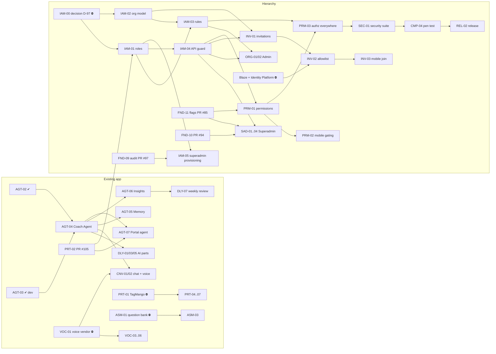

# LiveWell V2 — Dependency Map

Arrows mean "must be done first". Per-task dependencies are also in the master tracker.

## Critical paths

⛔ = blocked on a person, vendor or decision.

## Cross-links between existing and new work

| Existing | New | Link |
|---|---|---|
| PRT-02 staff roles (PR #105) | IAM-01 | Rename staff `admin`, add superadmin/org roles. Merge #105 first, then extend. |
| FND-06 rules | IAM-03 | Same rules file and coverage gate. |
| FND-07 migration (PR #96) | IAM-02 | Same migration tooling; org backfill is a new dry-run migration. |
| FND-09 audit (PR #97) | IAM-05, SAD-04 | New admin action names must be allow-listed. |
| FND-10 monitoring (PR #94) | SAD-03 | Dashboards build on it. |
| FND-11 flags (PR #85) | SAD-02, PRM-01 | Global flags become the base layer. |
| FND-04 shell | PRM-02 | Router and tab guards. |
| ONB-01 sign-in | INV-03 | Join flow inserted before onboarding; conflict with open sign-up. |
| AGT-01 service | PRM-03 | Endpoints check org/permission. |
| CMP-01 legal texts | IAM-00 | Terms/Privacy must describe the Admin role. |
| CMP-04 pen test | SEC-01 | Scope grows. |
| REL-02 store release | INV-03 | Invite-only app review (demo account). |

## Independent streams (safe to run in parallel)

1. **Existing app stream:** AGT-04 → AGT-05/06/07, DLY/CNV AI parts (Python agents + app).
2. **Review stream:** owner reviews and merges the 24 open PRs (no new code).
3. **Hierarchy stream:** starts only after D-97; IAM-01/02 touch Core API, rules and data model, not the agents. Conflicts with stream 1 are limited to `firebase/firestore.rules` and the data model, so rule changes go in small PRs.
